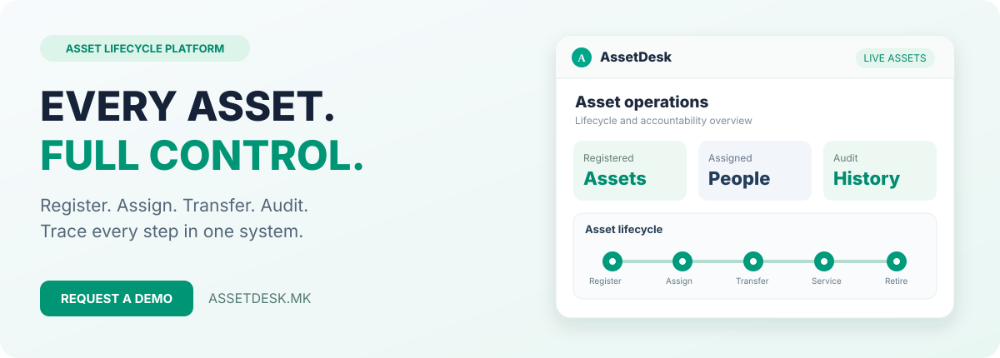

  

 

### Секое средство. Секоја промена. Целосна контрола.

[English](README.md) · [PROCESS IN](https://github.com/stambolce/process-in)

---

## AssetDesk — професионална платформа за секојдневната работа

AssetDesk е платформа на PROCESS IN за евиденција и управување со IT и материјално-технички средства. Ги поврзува регистарот на опрема, задолжувањето, преносот, QR идентификацијата, пописот и документацијата низ целиот животен циклус.

Целта е информациите, работните чекори и резултатите да бидат организирани во единствен систем со јасен визуелен идентитет и практичен кориснички интерфејс.

## Како функционира?

| Чекор | Што опфаќа |
|---|---|
| **01 — Регистрација** | Внесување средство со автоматски или рачно зададен инвентарен број. |
| **02 — Идентификација** | Поврзување на средството со QR ознака и брзо скенирање. |
| **03 — Задолжување** | Евиденција на корисник, организациска единица или локација. |
| **04 — Пренос** | Документирање пренос и промена на задолжување. |
| **05 — Попис** | Споредба на физичката состојба со дигиталната евиденција. |
| **06 — Сервис или отпис** | Следење на сервис, раздолжување и завршување на животниот циклус. |

## Главни функционалности

<table><tr><td width="50%" valign="top">

### Централен регистар
Структурирани записи за опрема, категории, идентификатори, локации и статус.

### QR ознаки и скенер
Брзо препознавање на опремата преку QR код и скенирање.

### Пренос и раздолжување
Следење на движења, предавања и враќање на опрема.

### Препознавање дупликати
Полесно откривање повторени записи при внесување и обработка.

### Попис и усогласување
Проверка на фактичката состојба во однос на евиденцијата.

</td><td width="50%" valign="top">

### Автоматски и рачни шифри
Автоматско генерирање или рачно внесување номенклатурни и инвентарни броеви.

### Задолжување и одговорност
Евиденција кој го користи средството и каде се наоѓа.

### PDF реверс документи
Генерирање документи за предавање, задолжување и враќање на средства.

### Увоз и извоз
Групна обработка и размена на податоци преку табеларни формати.

### Сервис и животен циклус
Историја на сервисирање, движења и завршување на употребата.

</td></tr></table>

## За кого е наменет?

- **IT оддели и администратори** — подобра организација на податоците и поврзан работен процес.
- **Компании со компјутери, лаптопи и канцелариска опрема** — подобра организација на податоците и поврзан работен процес.
- **Институции со материјално-технички средства** — подобра организација на податоците и поврзан работен процес.
- **Организации со повеќе локации и задолжени лица** — подобра организација на податоците и поврзан работен процес.
- **Тимови што вршат попис и инвентарна контрола** — подобра организација на податоците и поврзан работен процес.

## Што се подобрува во пракса?

| Вообичаен предизвик | Пристап на AssetDesk |
|---|---|
| Расфрлани Excel табели | Централна евиденција на средства |
| Нејасно задолжување | Запис за корисник и предавање |
| Тежок физички попис | QR ознаки и проверка |
| Недостасува реверс | PDF документи за задолжување |
| Повторени записи | Проверка на дупликати |

## Термини поврзани со производот

**евиденција на основни средства · IT опрема · инвентарни броеви · QR попис · реверс за опрема · задолжување и раздолжување · попис на средства · управување со опрема** — ова се релевантни области што ги покрива презентацијата на производот.

## Официјални информации

| | |
|---|---|
| **Производ** | [AssetDesk](https://assetdesk.mk) |
| **Производител** | [PROCESS IN](https://processin.mk) |
| **Веб-страница** | https://assetdesk.mk |
| **Намена** | Евиденција и управување со IT и материјално-технички средства |
| **Портфолио** | [PROCESS IN GitHub](https://github.com/stambolce/process-in) |
| **Регистар** | [PROCESS IN — регистар на производи](https://github.com/stambolce/process-in/blob/main/docs/registry.mk.md) |

### Евидентирано. Следено. Под контрола.

---

Официјална јавна презентација на PROCESS IN. Не се објавуваат приватен изворен код, кориснички податоци или продукциски пристапи. Достапноста на опциите и конфигурациите зависи од актуелната понуда.
